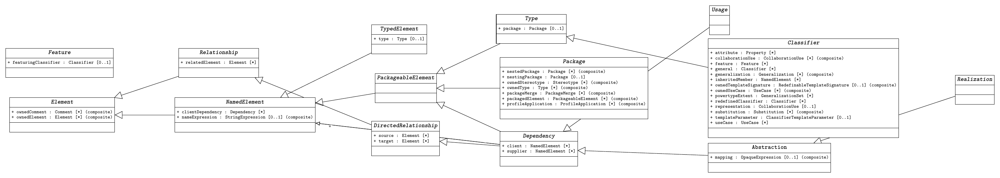

# uml-ontology

An OWL 2 ontology and SHACL shapes for the relationship vocabulary of UML and its
UML-based children: **UML 2.5.1**, the **UML Standard Profile**, **SysML v1**, **UAF**,
**BPMN 2.0** and the **SysML v2** abstract syntax.

Both artifacts are **generated** from the OMG metamodels — nothing is hand-entered. The
source metadata (class hierarchy, typed ends, multiplicities, composites, subset links,
recorded opposites, normative OCL bodies, stereotype base metaclasses) is preserved by
[`umlmeta`](https://github.com/mycr0ft/umlmeta)'s generated runtimes, so this repo is a thin,
honest projection of the standards rather than a second opinion about them.

    ontology/uml-family-relationships.ttl   OWL 2 DL, Turtle      ~25k triples, 1.3 MB
    ontology/relationships.json             the same facts, no RDF stack needed
    shapes/uml-family-shapes.ttl            SHACL                  812 node shapes
    shapes/authored-multiplicity.ttl        SHACL, hand-written    4 shapes, for model bounds
    shapes/untranslated.json                every constraint SHACL does NOT check, with why
    PLAN.md                                 the gaps that are left, each with the number it moves

    count
      898  classes                     (uml, sp, sysml, uaf, bpmn, sysml2)
    2,023  declared features           every one described or registered: 1,640 + 356 + 27
    1,640  association ends            object property, domain + range from the own typing
      356  attributes                  datatype-valued or enumeration-valued
       53  enumerations                250 literals, each an individual
      586  inverse pairs               only where BOTH ends name each other
      344  profile stereotypes         each with its base metaclass axiom
     37  subset targets named but not declared    the features the feeds omit
    2,255  normative OCL constraints
      812  SHACL node shapes          cardinality from lo/hi + a translated OCL subset
      113  OCL constraints translated  18 facet-shaped + 95 same-object comparisons
    2,142  registered as not translatable, each with a reason class

`docs/coverage.md` is the register behind those numbers: what each feature became, the 27
that became nothing and why, and what the next concepts would cost to add. Two properties in the
ontology are not feed facts at all — `uml:Element__owner` and `uml:NamedElement__namespace`,
which UML 2.5.1 states and the feeds omit; each carries the clause it comes from in
`umlmeta:specClause`. `PLAN.md` lists what is still missing, ranked by the count that moves.

## Why the SHACL number is 113 and not 2,255

UML's serialized invariants are overwhelmingly implications, closures, set operations and
library predicates — `mustBeOwned() implies owner->notEmpty()`,
`allInstances()->select(...)`, `specializesFromLibrary('X')`. Translating those into SHACL
would mean writing an OCL evaluator, and a *partial* translation is worse than none: it
publishes a weaker rule under the constraint's name.

So the shapes do two things, and say which:

* **cardinality** — every feature's `lo`/`hi` becomes `sh:minCount`/`sh:maxCount` on its
  declaring class. That is the metamodel's own rule and it covers 812 shapes. The same bound is
  stated twice more in the ontology, for consumers that are not SHACL validators:
  `umlmeta:lower`/`umlmeta:upper` on all 1,996 described features, and an
  `owl:minCardinality` restriction on the 16 features whose lower bound is stated;
* **the whitelisted OCL subset** — 113 constraints whose form maps onto SHACL with no
  interpretation. 18 are facet-shaped (`isEmpty`, `notEmpty`, `size()` comparisons,
  `oclIsUndefined`, `oclIsKindOf`, one-level universal) and 95 are same-object comparisons,
  compiled whole into `sh:and`/`sh:or`/`sh:not` trees over property shapes, one node shape per
  constraint and named after it (`<owner>_<constraint>`, carrying `umlmeta:oclName` and
  `umlmeta:oclBody`). An absent Boolean test reads as false, `= null` as "no value" and
  `<> null` as "at least one value" — SHACL core, no SPARQL.

Everything else is in `shapes/untranslated.json` with the reason it was refused, because a
consumer must be able to tell "no violation" from "not checked".

## Three grades, kept apart

| grade | meaning | where it lives |
|---|---|---|
| **stated** | the metamodel says it: a typed end, a subclass axiom, a constraint body | OWL + SHACL |
| **implied** | the profile constrains more than the typing does («satisfy» from Requirement to Block is SysML's rule, not UML's) | *not yet emitted* |
| **observed** | an instance corpus shows the pair occurring — evidence, never a rule | *not yet emitted* |

`Dependency.client` is typed `NamedElement`, so the ontology deliberately does not narrow
what a dependency may connect. Anything narrower belongs to the second grade and will be
generated from the profile's clauses, not guessed.

## Documenting the metamodel

The fact book is a model, so the figures are generated from it rather than drawn by hand:

    cd docs && make relationships     # figures/relationships.pdf, .png
    cd docs && make check             # 9 checks: no overlap, no dangling edge, compiles

`docs/umltikz.sty` is UML class notation over TikZ (three-compartment boxes, abstract names in
italics, hollow-triangle generalization, association multiplicities, dashed dependencies), and
`docs/tools/` drives it from `ontology/relationships.json`. Box widths are measured by TeX, not
estimated: an estimated width overlapped boxes while still compiling. Straight edges only for
now — an association whose route would cross an unrelated box is skipped and named in
`associationsSkipped` rather than drawn where nobody can follow it. See `docs/README.md`.

## Running it

Needs Python 3.10+ and `umlmeta` (installed, or a checkout pointed at by `UMLMETA_SRC`):

    export UMLMETA_SRC=~/proj/umlmeta/src      # or: pip install umlmeta

The artifacts in this repo were generated against `umlmeta`
`2157df97861d1d3438353a735cb6275eda913986`, and CI installs that commit. The PyPI release
(0.2.0) predates it and yields 1,297 object properties instead of 1,640, so the drift check
would fail against the published package; pinning the commit is what keeps "regenerate and
compare" meaningful.
    python scripts/build_ontology.py           # writes ontology/
    python scripts/build_shacl.py              # writes shapes/
    python check.py                            # 65 checks; RDF half needs rdflib

`check.py` skips its RDF half loudly when `rdflib` is absent. To run it fully:

    pip install rdflib
    python check.py

The gate proves more than "the files exist": every `sh:path` must resolve to a property the
ontology defines, every shape must target a class it defines, and the untranslated register
must account for every constraint in the metamodels.

Then the shapes are made to fire against real graphs:

    pip install pyshacl
    python tests/test_shacl.py

Eight cases: an `Association` with two member ends conforms, one with a single end is rejected
on `Association__memberEnd`; a binary `sysml:Allocate` conforms, one with two sources is
rejected on `DirectedRelationship__source`; a shape emitted once on `TypedElement` reaches a
`Class` instance; and a bare `Association` is rejected, which proves the validator can fail at
all. Each negative case asserts *which* path fired, not merely `conforms == False` — a shape
pointing at the wrong property would still fail the graph and would still pass a weaker test.

The bounds a *model* writes are checked separately, by four hand-written shapes in
`shapes/authored-multiplicity.ttl` (kept out of the generated file so regeneration cannot clobber
them) and twelve cases in `tests/test_authored_multiplicity.py`: a bound must be a readable
literal, non-negative, single-valued, and never below its partner. That file is the one place
`sh:class uml:ValueSpecification` is deliberately not used — with RDFS inference it is satisfied
by the range axiom itself, so it accepts a `uml:Class` used as a bound.

Navigability is the case where the check is a derivation rather than a shape:
`tests/test_navigability.py` (five cases) computes `navigable(A) = memberEnd(A) - ownedEnd(A)`
over two fixtures, because UML 2.5.1 9.5.3 makes `isNavigable` derived and core SHACL cannot
condition on the absence of an inverse link. The ontology supplies the inputs and the subset
chain; it does not store the flag.

## Known limits

* Untyped `Dependency` ends are left unconstrained rather than narrowed by guesswork.
* Cardinality is only as precise as `umlmeta`'s declared multiplicities. A feature declared
  without `lo`/`hi` becomes `0..1`, so `uml:Generalization__general` is bounded at most one
  but not required. `tests/test_shacl.py` pins the current behaviour, and closing the gap is a
  data question in `umlmeta` (the source XMI it was generated from is not retained here, so
  whether the end is `1..1` upstream is a question to answer there, not a claim to make here).
* Enumeration and primitive features are now emitted (`owl:DatatypeProperty` with an XSD
  range, or an object property ranging over an enumeration class), but they are **not** in
  `relationships.json`'s `"properties"` list: that list feeds the generated figure, and adding
  356 rows would redraw every box in it. They live under `"attributes"`.
* `lower <= upper` is not asserted anywhere: OWL cannot say it and nothing in `umlmeta`'s data
  violates it, so it is a gap rather than a claim. 27 features are registered as unmapped with
  their reasons (18 untyped in `sysml2`, 8 DOM nodes, 1 `BPMNDI`); see `docs/coverage.md`.
* OCL bodies are carried as OCL source annotations; they are not translated into OWL axioms.
* The SysML v2 namespace is the abstract syntax (`sysml2:`), because that is what `umlmeta`
  generates. Cross-language alignment (`sysml:Allocate` ↔ the v2 `AllocationUsage`) follows
  `umlmeta`'s `v1_to_v2_as.py` mapping tables and is the next artifact.

## Provenance and licence

Class hierarchy and feature typing come from the OMG-published metamodel XMI that
`umlmeta`'s `generate*.py` consumed; the OCL bodies are the normative constraints from those
documents. The profile packages are the SysML v1, UML Standard Profile, UAF and BPMN
metamodel serialisations `umlmeta` already generates.

Code: MPL-2.0. Generated artifacts are derived from OMG specifications, which retain their
own copyright; see `LICENSE` and `NOTICE`.
